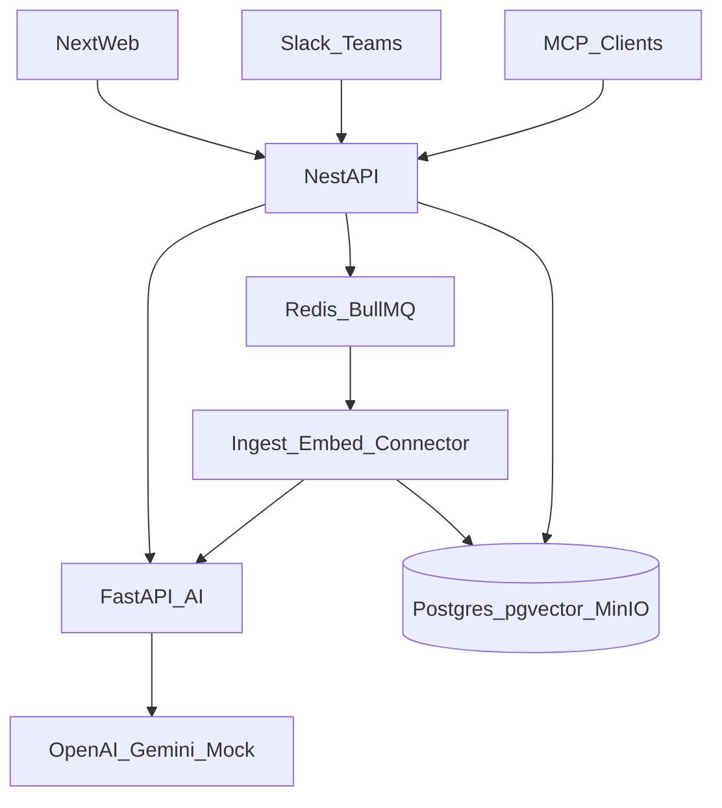

# AI Knowledge Base Platform — Architecture

Mapped from the target platform diagram and three competitive pillars, plus **enterprise parity** layers inspired by Glean / Copilot / Guru / Notion.

## Layer map (diagram → this repo)

| Diagram | This monorepo | Notes |
|---|---|---|
| Frontend Next.js + TS + Tailwind | `apps/web` | Same |
| Backend Node + Express (Auth, RBAC, Bot, File, Chat) | `apps/api` **NestJS** | Nest = Express-class API; same responsibilities |
| Processing OCR/PDF/DOCX/XLSX + Semantic Chunking | `apps/ai` FastAPI | Parse/OCR/chunk + DLP redact |
| AI Engine OpenAI/Gemini Embedding+LLM | `apps/ai` + org settings | mock / openai / gemini |
| Qdrant Vector DB | **Postgres + pgvector** | Same role: vector retrieval |
| MongoDB Users/Bots/Files/Chats | **Postgres (Prisma)** | Relational model instead of document DB |
| Redis + BullMQ jobs | Redis + BullMQ | Ingestion, embedding, connector sync |

## Three pillars (+ enterprise parity)

### 1. Document Intelligence
- PDF (text + OCR scan), DOCX, TXT/MD, images, **XLSX**, markdown **notes**
- Semantic / structure-aware chunking (pages, headings, sheets, tables-as-rows)
- **DLP**: PII/secret redaction on embed/generate (`apps/ai/app/dlp.py`)

### 2. Retrieval Quality
- Hybrid search (vector + FTS) + RRF + local rerank
- LLM query rewrite, multi-hop research, cited answers
- **Verified-only** filter + soft boost for verified sources
- **Eval runs** with score dashboard (`/eval-runs`)

### 3. Enterprise Management
- Org RBAC, ACL modes, connectors, async jobs
- **Multi-bot**: named assistants bound to a knowledge base
- **Governance (Guru-like)**: `trustStatus`, verify/unverify, owner, expiry
- **Connectors**: local, Google Drive (+ external ACL → DocumentAcl), Notion/Confluence/Slack export
- **Surfaces**: Slack slash + Teams webhook (`/integrations/...`)
- **Identity**: OIDC Google/Microsoft (+ stub), SCIM user provision/disable
- **Audit trail** UI + API
- **People graph**: entities + links (members, ownership, title mentions)
- **MCP**: read-only `search` / `get_document` + `create_task_stub` with org tokens
- **Quotas / retention** org settings

## Out of scope for literal diagram swap
- Migrating to MongoDB or Qdrant (no functional gain for current stage)
- Replacing Nest with Express
- Full realtime Notion-style collab editor / 100+ production connectors / SOC2 process
